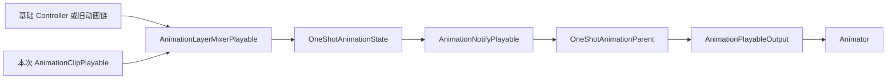
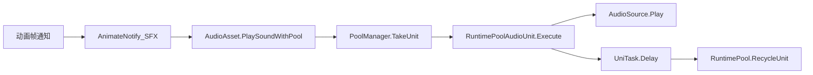
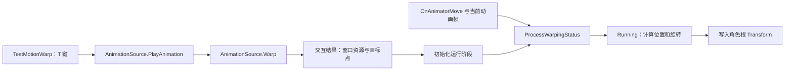
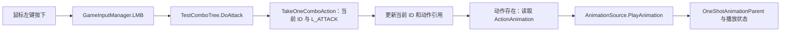
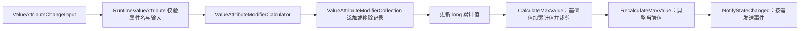

# ARPG Demo 脚本项目文档

## 当前实现（2026-11-10）

本节说明当前源码；下方 PartA、PartB、PartC 是对应日期的历史记录，其中目录、接口和未实现事项不能作为当前实现依据。Assets/Scripts/Runtime 是业务代码层，包含近战、角色移动与相机、动画、输入、背包货币、属性、状态效果、事件及对象池。

| 模块 | 当前入口与约定 |
| --- | --- |
| 近战 | [MeleeCombatController](../Assets/Scripts/Runtime/MeleeSystem/Combat/MeleeCombatController.cs) 协调武器、连招、命中和状态机；保留状态与动画回调所有权保护。输入配置、枚举及按钮绑定集中在 MeleeSystem/Input，通知上下文在 MeleeCombatEvents.cs。 |
| 动画与根运动 | [AnimationSource](../Assets/Scripts/Runtime/Animation/AnimationSystem/AnimationSource.cs) 通过 IAnimationState.UseRootMotion 遵循动作配置；Animator 直接应用时对移动组件输出零权重，关闭根运动和完成时清空位移、旋转与权重。 |
| Motion Warping | [AnimationMotionWarpingControl](../Assets/Scripts/Runtime/Animation/AnimationMotionWarping/AnimationMotionWarpingControl.cs) 保存目标局部锚点并随目标变换更新；仅有效窗口接管变换，跳过过期窗口，零长度窗口立即完成，取消或目标失效清理上下文。显式 Warping 独立于普通根运动开关。 |
| Warping 编辑器 | [MotionWarpingAssetEditor](../Assets/Scripts/Editor/Animation/MotionWarpingAssetEditor.cs) 使用临时模型采样，保留原算法，完成后记录 Undo 并标脏资产；配置中的原模型不参与修改。 |
| 背包与分解 | [CharacterBag](../Assets/Scripts/Runtime/Inventory/Bag/CharacterBag.cs) 的 CanAddItems / TryAddItems 合并重复产物，按分解前容量检查，完整写入后发送事件，再由 RuntimeItem 消耗原物品。 |
| 货币 | GetCurrency / TrySpendCurrency / RemoveCurrency 使用 CurrencyCategory；同币种面额共享余额，None 无效；CurrencyChanged 参数为币种和余额。名称只用于显示。 |
| 背包编辑器 | [CharacterBagEditor](../Assets/Scripts/Editor/Inventory/CharacterBagEditor.cs) 通过 GetItems / GetCurrencies 快照显示运行时内容，提供使用、出售、分解按钮；业务组件不维护调试视图。ItemAsset.Icon 为 Sprite。 |
| 连招编辑器 | [ComboTreeAssetEditor](../Assets/Scripts/Editor/ComboTree/ComboTreeAssetEditor.cs) 通过行绑定 ID 删除，重建与 Undo/Redo 后重新解析详情对象；空行清除旧标签。 |
| 移动与滑索 | [ThirdPersonLocomotion](../Assets/Scripts/Runtime/Character/Movement/ThirdPersonLocomotion.cs) 的 Editor 引用条件编译；游泳退出恢复碰撞体与运动参数；[Zipline](../Assets/Scripts/Runtime/Character/Movement/AddOn/Zipline/) 中 Rope 提供几何数据，方向反转由各角色持有。 |

目录调整：AnimatorAgent 位于 Runtime/Character/Animation；Priority 位于 Utilities/Priority；音频通知位于 AnimationNotify/GameNotifies/Notifies；动画播放、Warping、日志通知演示位于 Test/Animation，退款示例位于 Test/EventCenter。已有脚本移动保留原 .meta / GUID。

接口命名：AnimationPlaybackTest 替代 TestPool；EnsureAvailableUnits 的参数表示目标空闲数量；移动内部方法为 InitializeCamera、UpdateMovement、UpdateRotation，近战启动方法为 StartAttack。删除未使用的动画播放重载和 ResetAnimationState 接口。

**资源边界：** 旧连招资源中的 m_TreeDataLink、m_ComboActionAsset、m_ActionTriggerSignal 本次不迁移、不重写；等待用户手动替换，代码验证使用当前结构数据。整份注释的 EquipWeaponAction 保留，冲刺仍未补全。Water / Zipline 触发器要求项目配置对应标签。

验证入口见 [Tests/Scripts](../Tests/Scripts/README.md)、[Tests/MeleeSystem](../Tests/MeleeSystem/README.md)，实际结果与未验证项见 [本次交付记录](ScriptsOptimization.md)。

## PartA（历史记录）

> 更新日期：2026-11-03。范围：`Assets/Scripts/` 当前磁盘源码。
> 本文通过静态阅读整理，未启动 Unity Play Mode；场景挂载、资源配置及运行效果未在本次验证。

### 1. 项目概况

当前脚本提供 ARPG 项目的基础设施，核心是 **Playables 动画播放与帧通知、增强输入、泛型事件中心**，另有全局管理器、单例和通用工具。目前尚未在此目录中形成完整的角色移动、战斗、技能或背包业务系统。

当前共 40 个 C# 文件，其中 1 个为 Input System 自动生成的 `GP_InputAction.cs`。手写脚本使用 `GP` 命名空间；生成的输入包装类未声明命名空间。

| 模块 | 主要用途 | 阅读入口 |
| --- | --- | --- |
| 动画系统 | 将一次性动画混入基础 Animator 动画，管理播放状态、过渡和打断 | [AnimationSource.cs](../Assets/Scripts/Runtime/Animation/AnimationSystem/AnimationSource.cs) |
| 动画通知 | 按动画帧触发单次通知和区间通知，维护每次播放的独立状态 | [RuntimeWrapperManager.cs](../Assets/Scripts/Runtime/Animation/AnimationNotify/AnimationNotifyWrapper/RuntimeWrapperManager.cs) |
| 输入系统 | 统一读取方向输入、处理按钮和长按／连按交互 | [GameInputManager.cs](../Assets/Scripts/Runtime/InputSystem/GameInputManager.cs) |
| 事件中心 | 按数据类型发布与订阅消息，通过令牌取消订阅 | [EventCenter.cs](../Assets/Scripts/Runtime/EventCenter/EventCenter.cs) |
| 全局管理 | 维护游戏模式、鼠标状态和单例生命周期 | [GameManager.cs](../Assets/Scripts/Runtime/Manager/GameManager.cs) |
| 工具层 | 提供时间换帧、数学、组件、序列化、日志和 Gizmos 辅助 | [Utilities](../Assets/Scripts/Utilities/) |

### 2. 目录结构

```text
Assets/Scripts/
├─ Runtime/
│  ├─ Animation/
│  │  ├─ AnimationSystem/             # Playable 图、动画资源及播放状态
│  │  │  └─ Interfaces/              # IAnimationState、打断请求和播放状态枚举
│  │  └─ AnimationNotify/
│  │     ├─ Base/                    # 单次通知与区间通知的抽象定义
│  │     ├─ AnimationNotifyWrapper/  # 每次播放的包装器及通知调度
│  │     └─ Test/                    # 输出日志的通知示例
│  ├─ InputSystem/
│  │  ├─ InputActionAssets/          # .inputactions 配置及生成类
│  │  ├─ EnhancedInput/              # 输入包装器、值输入、按钮输入
│  │  └─ EnhancedInputInteractions/ # 长按、连按和交互接口
│  ├─ EventCenter/                   # 事件通道、订阅令牌和退款示例
│  ├─ Manager/                       # GameManager
│  └─ Other/Priority/                # 优先级定义及权重扩展
└─ Utilities/
   ├─ Animation/                     # 动画时间与帧转换
   ├─ Log/                           # EMTLog
   ├─ Serializable/                  # 可序列化字典基类
   ├─ Singleton/                     # MonoBehaviour 单例基类
   ├─ ToggleableValue/               # 可启用／禁用的值配置
   └─ 其他数学、组件和 Gizmos 工具
```

`Runtime` 内的模块会复用 `Utilities`，但当前依赖不是严格单向的：例如 `SingletonMono<T>` 会检查 `GameManager.GameRunning`。输入、事件和动画之间尚未建立完整的业务连接；`AnimationSource` 的 F 键测试也没有经过 `GameInputManager.FKey`。

### 3. 环境与依赖

| 项目 | 当前配置或源码用途 |
| --- | --- |
| Unity | `6000.5.8f1`，见 [ProjectVersion.txt](../ProjectSettings/ProjectVersion.txt) |
| Input System | `1.20.0`，用于输入资源、输入包装及键盘测试 |
| Unity Animation / Playables | 用于动画图、Clip 播放、分层混合和通知传递 |
| Odin Inspector | 源码引用 `Sirenix.OdinInspector`，用于 Inspector 分组、条件显示和参数提示 |
| Visual Scripting | `ComponentUtils` 引用其命名空间及 `AddComponent<T>` 扩展用法 |

包版本依据 [manifest.json](../Packages/manifest.json)。输入生成类头部标注生成器版本为 `1.19.0`，这与当前 manifest 中的 Input System 版本不同；该标注记录生成时版本。

### 4. 动画播放系统

#### 4.1 主要类型

| 类型 | 职责 |
| --- | --- |
| [AnimationAsset](../Assets/Scripts/Runtime/Animation/AnimationSystem/AnimationAsset.cs) | ScriptableObject 动画配置，保存 Clip、速度、名称、标签、优先级、Mask、过渡曲线及通知列表 |
| [AnimationSource](../Assets/Scripts/Runtime/Animation/AnimationSystem/AnimationSource.cs) | 场景组件；查找 Animator，创建和销毁 PlayableGraph，提供当前状态查询 |
| [OneShotAnimationParent](../Assets/Scripts/Runtime/Animation/AnimationSystem/OneShotAnimationParent.cs) | 管理活动动画状态、当前状态、播放请求、打断及通知节点 |
| [OneShotAnimationState](../Assets/Scripts/Runtime/Animation/AnimationSystem/OneShotAnimationState.cs) | 一次播放实例；创建 Clip 和 Mixer，计算时间、帧、权重，完成后拆除节点 |
| [IAnimationState](../Assets/Scripts/Runtime/Animation/AnimationSystem/Interfaces/IAnimationState.cs) | 统一暴露播放时间、进度、权重、帧、名称／标签及打断操作 |
| [AnimationNotifyPlayable](../Assets/Scripts/Runtime/Animation/AnimationSystem/AnimationNotifyPlayable.cs) | 接收当前动画状态推送的帧通知，并交给运行时包装器管理器 |

#### 4.2 动画资源配置

在 Project 窗口通过 **Create → GP → Animation → AnimationAsset** 创建配置资源。

- **基础配置**：`AnimationClip`、`Speed`、`UseRootMotion`。
- **混合配置**：是否使用 AvatarMask、Mask 资源，以及 `Additive`／`Override` 模式。
- **识别与打断**：`AnimationName`、`AnimationTag`、`AnimationPriority`。
- **过渡配置**：缓入／缓出时长及对应 AnimationCurve。
- **通知配置**：单次通知列表与区间通知列表，使用 `SerializeReference` 保存派生类型。

其中 `UseRootMotion` 当前只是配置项，不能据此认为自定义根运动处理已经接通，具体边界见第 9 节。

#### 4.3 创建和播放流程

1. `AnimationSource.Awake()` 查找自身及子物体上的 Animator。
2. `m_AutoCreate` 开启时调用 `CreateGraph()`。
3. Animator 存在 Controller 时，将它包装成 `AnimatorControllerPlayable` 作为基础动画源。
4. 创建通知节点和 `OneShotAnimationParent`，再连接到 Animator 的动画输出；原 `runtimeAnimatorController` 引用设为 `null`，Controller 改由图节点驱动。
5. `m_PlayOnAwake` 开启时播放图。
6. 当前测试入口在 `Update()`：按 F 调用 Parent 的 `PlayAnimation(AnimationAsset)`。
7. 每次播放创建新的 `OneShotAnimationState`，将旧动画链与本次 Clip 混合，并设置本次通知。
8. 播放完成后重新连接上游动画链，移除本次节点；对象销毁时清理状态和图。

单次动画接入后的数据流如下。连续播放时，图中可暂时保留正在淡出的旧状态。



#### 4.4 状态、过渡和打断

`AnimationRunningStatus` 定义 `EaseIn → Running → EaseOut → Done`。状态实例根据时间和资源曲线计算权重，并通过 `AnimationLayerMixerPlayable` 混合本次动画。启用 AvatarMask 时，可设置遮罩及叠加模式。

`InterruptRequest` 包含请求优先级和淡出时长。普通 `InterruptAnimation()` 只接受不低于当前动画优先级的请求，并在状态处于 `Running` 时处理已记录的请求；`ForceInterruptAnimation()` 直接进入打断处理。当前 `PlayAnimation(asset)` 默认强制打断上一个动画，旧状态可以继续淡出，但不再推进新动画的通知。

`Priority` 顺序为 `None < Low < Normal < High < Max`，`Weight()` 返回枚举的整数值。它用于动画打断判定，不是输入或事件的全局调度器。

### 5. 动画通知系统

#### 5.1 通知定义与运行时状态

通知定义保存在 `AnimationAsset` 中，每次播放的执行状态保存在独立包装器中。排序、已触发标记和进入／退出状态不会写回资源列表；通知定义对象本身仍由包装器引用。因此，新增通知时应避免把某个角色本次播放的可变状态保存在共享通知定义中。

| 类型 | 行为 |
| --- | --- |
| [AnimationNotify](../Assets/Scripts/Runtime/Animation/AnimationNotify/Base/AnimationNotify.cs) | 在 `TriggerFrame` 调用一次 `TriggerNotify(GameObject user)` |
| [AnimationStateNotify](../Assets/Scripts/Runtime/Animation/AnimationNotify/Base/AnimationStateNotify.cs) | 定义 `StartFrame`、`EndFrame`，提供 Enter、Tick、Exit 回调 |
| [RuntimeNotifyWrapper](../Assets/Scripts/Runtime/Animation/AnimationNotify/AnimationNotifyWrapper/RuntimeNotifyWrapper.cs) | 保存触发帧、原列表索引和已触发标记，避免重复执行 |
| [RuntimeStateNotifyWrapper](../Assets/Scripts/Runtime/Animation/AnimationNotify/AnimationNotifyWrapper/RuntimeStateNotifyWrapper.cs) | 保存进入、退出、打断标记，保证退出只执行一次 |
| [RuntimeWrapperManager](../Assets/Scripts/Runtime/Animation/AnimationNotify/AnimationNotifyWrapper/RuntimeWrapperManager.cs) | 排序运行时包装器、推进帧游标、补发跳过的帧并统一打断 |

当前通知的 `user` 来自 `animator.transform.root.gameObject`。编写伤害、音效等派生通知时，应根据这个对象查找需要的组件。

#### 5.2 帧推进规则

`OneShotAnimationState.PrepareFrame()` 根据 Clip 的时间和帧率计算当前帧，通过 `PushNotification()` 发送 `AnimationNotifyFrameData`。通知节点核对来源状态后，调用 `RuntimeWrapperManager.EvaluateFrame(currentFrame)`。

管理器从上次帧逐帧推进到目标帧，而不是只检查目标帧，因此低帧率导致的跳帧仍会补发经过的通知。这里的 Tick 是 **动画整数帧 Tick**，不是每个 Unity 渲染帧一次。

同一动画帧内，执行顺序为：

1. 到达触发帧的单次通知。
2. 到达开始帧的区间通知 Enter。
3. 所有满足 `StartFrame < 当前帧 < EndFrame` 的区间通知 Tick。
4. 到达结束帧的区间通知 Exit。

同一类、同一触发帧的通知保留 Inspector 列表顺序；不同类别之间遵循上面的执行顺序。重复或倒退的帧请求会被忽略。管理器会跳过空通知、负帧通知，以及结束帧小于开始帧的区间通知。

例如，区间为第 2～5 帧：第 2 帧 Enter，第 3、4 帧 Tick，第 5 帧 Exit。若从第 1 帧直接推进到第 5 帧，上述回调仍依次补齐。开始帧等于结束帧时，会在同帧 Enter 后 Exit，没有 Tick。

#### 5.3 切换、完成与打断

- 每次播放都会创建新的管理器；即使新资源没有通知，也会先清理旧通知。
- 旧状态或已经排队的旧通知通过来源状态校验被过滤，避免推进新状态的游标。
- 动画完成时，先处理末帧，再清理通知；超出最后可计算帧的通知不会正常到达。
- 中途打断时，已 Enter 且尚未 Exit 的区间通知补一次 Exit；未进入的区间不会凭空 Exit。
- 管理器一旦打断，不再继续推进；它不提供倒放、回退或循环重置功能。

已有的 [LogAnimationNotify](../Assets/Scripts/Test/Animation/LogAnimationNotify.cs) 和 [LogAnimationStateNotify](../Assets/Scripts/Test/Animation/LogAnimationStateNotify.cs) 通过 `EMTLog` 输出日志，用于观察执行时机，属于演示实现。

#### 5.4 最小接入步骤

1. 创建 `AnimationAsset` 并指定有效的 AnimationClip。
2. 根据需要添加日志通知，设置合法帧范围；帧从 0 开始，结束帧应处于 Clip 可达范围内。
3. 在角色上挂载 `AnimationSource`，确保能找到 Animator，将资源赋给公开的 `AnimationAsset` 字段。
4. 保持自动建图和自动播放开启，在有键盘的编辑器环境中进入 Play Mode，聚焦 Game 窗口后按 F。
5. 观察动画和日志；连续触发时检查旧区间退出、新通知独立触发的表现。

以上为按源码整理的操作路径，本次未执行这些运行验证。扩展功能时，可继承两类通知基类，实现单帧效果或持续区间行为。

### 6. 增强输入系统

#### 6.1 配置与管理入口

[GP_InputAction.inputactions](../Assets/Scripts/Runtime/InputSystem/InputActionAssets/GP_InputAction.inputactions) 是输入配置源，[GP_InputAction.cs](../Assets/Scripts/Runtime/InputSystem/InputActionAssets/GP_InputAction.cs) 是自动生成的访问包装。修改按键和 Action 应在 `.inputactions` 中完成，再重新生成，避免手改生成文件。

输入资源包含 `GamePlay` 和 `GameUI` 两个 Action Map。当前 `GamePlay` 有 34 个 Action，涵盖方向、视角、鼠标位置、字母键、数字键及鼠标按钮等；`GameUI` 为空。资源里定义了某个 Action，不代表管理器已经为它提供公开输入对象。

`GameInputManager` 当前公开以下 5 个包装对象：

| 管理器属性 | 对应 Action | 当前绑定 | 使用方式 |
| --- | --- | --- | --- |
| `MovementInput` | `MovementKey` | WASD 组合、手柄左摇杆 | `ReadInputValue()` 返回 Vector2 |
| `LookInput` | `MouseLook` | 鼠标 delta、手柄右摇杆 | `ReadInputValue()` 返回 Vector2 |
| `QKey` | `Q` | 键盘 Q | 订阅按钮事件／附加交互 |
| `EKey` | `E` | 键盘 E | 同上 |
| `FKey` | `F` | 键盘 F | 同上 |

`GameInputManager` 继承持久化单例。在 `AwakeSingleton()` 中创建输入对象，在 `OnEnable/OnDisable` 中启停输入资源并连接／解除按钮回调，在 `Update()` 中轮询需计时的交互，销毁时执行资源清理。包装器构造时会向管理器注册自己。

#### 6.2 输入包装与交互

| 类型 | 职责 |
| --- | --- |
| [EnhancedInput](../Assets/Scripts/Runtime/InputSystem/EnhancedInput/EnhancedInput.cs) | 输入包装抽象基类，定义启用、禁用和销毁接口 |
| [ValueInput&lt;TValue&gt;](../Assets/Scripts/Runtime/InputSystem/EnhancedInput/ValueInput.cs) | 读取结构体输入值；包装器禁用时返回默认值 |
| [EnhancedButton](../Assets/Scripts/Runtime/InputSystem/EnhancedInput/EnhancedButton.cs) | 将 InputAction 的 `started/canceled` 转为按下、松开及交互处理 |
| [IEnhancedInputInteraction](../Assets/Scripts/Runtime/InputSystem/EnhancedInputInteractions/IEnhancedInputInteraction.cs) | 定义交互开始、结束及交互事件；Tick 子接口增加轮询能力 |
| [EnhancedInputHold](../Assets/Scripts/Runtime/InputSystem/EnhancedInputInteractions/EnhancedInputHold.cs) | 长按达到阈值触发，可选择按住自动触发或松开时判定 |
| [EnhancedInputMultiTap](../Assets/Scripts/Runtime/InputSystem/EnhancedInputInteractions/EnhancedInputMultiTap.cs) | 按下时累计连按次数，超过间隔后以当前按下作为新序列起点 |

按钮按下时先执行 `OnButtonPressedEvent`，再调用交互的 `BeginInteraction()`；松开时先调用 `EndInteraction()`，仅返回 `false` 时执行 `OnButtonReleasedEvent`。因此，普通按下事件不是“短按成功”事件。

长按成功后会抑制这次普通松开事件；时长不足则保留普通松开事件。连按交互的 `EndInteraction()` 始终返回 `true`，所以附加连按后，普通松开事件会被抑制，成功结果通过 `InteractionTriggered` 获取。当前连按间隔使用严格小于判断，恰好等于阈值时也会重新计数。

需要计时的长按交互在设置后加入管理器轮询集合；移除采用待移除标记和列表，在遍历结束后从集合移除。

#### 6.3 使用示意

以下语句应放在业务组件的适当生命周期中；退订时保留并使用原回调及交互对象。

```csharp
// 读取移动输入，例如在业务组件的 Update 中执行。
Vector2 movement = GameInputManager.Instance.MovementInput.ReadInputValue();

// 为 Q 设置 0.5 秒自动触发的长按交互。
var hold = new EnhancedInputHold(0.5f, true);
hold.InteractionTriggered += HandleHold;
GameInputManager.Instance.QKey.SetInteraction(hold);

// 业务组件退出时，使用同一个对象解除交互和回调。
GameInputManager.Instance.QKey.RemoveInteraction(hold);
hold.InteractionTriggered -= HandleHold;
```

示例中的 `HandleHold` 是业务组件自行实现的无参方法；设置和移除应分别放在启用、停用等对应阶段。每个按钮当前只保存一个交互对象。

### 7. 泛型事件中心

#### 7.1 主要类型与调用关系

| 类型 | 职责 |
| --- | --- |
| `IEventContext` | 事件数据标记接口；数据还必须是 struct |
| `EventCenter<TValue>` | 每个数据类型独立的静态事件通道，提供 `Subscribe` 和 `Publish` |
| [GameEventToken&lt;TValue&gt;](../Assets/Scripts/Runtime/EventCenter/GameEventToken.cs) | 保存本次订阅的回调，通过 `Unsubscribe()` 取消订阅 |
| `IEventToken` | 暴露 `IsDisposed` 与 `Unsubscribe()`，不实现 IDisposable |
| [GameEventTokenBinder](../Assets/Scripts/Runtime/EventCenter/GameEventTokenBinder.cs) | 用 HashSet 收集令牌，提供添加、移除、查询和批量注销 |
| [RefundEventExample](../Assets/Scripts/Test/EventCenter/RefundEventExample.cs) | 用退款金额与余额演示发布、接收和退订 |

典型调用关系：`订阅回调 → 获得令牌 → Publish(事件数据) → 同步执行回调 → 令牌.Unsubscribe()`。

例如，`EventCenter<RefundEvent>` 只接收 `RefundEvent` 数据，不与其他事件类型共享通道。事件在发布调用中同步执行，当前没有消息队列、异步派发或订阅优先级机制。


### 8. 全局管理与通用工具

#### 8.1 GameManager 与单例

`GameManager.GameManagerWake()` 使用 `SubsystemRegistration` 初始化入口，把 `GameRunning` 设为 true，再访问单例。`AwakeSingleton()` 默认切换到 `Game` 模式。

| 模式 | 当前鼠标行为 |
| --- | --- |
| `MainMenu`、`Menu` | 显示鼠标，解除锁定 |
| `Game`、`Loading` | 隐藏鼠标，锁定鼠标 |

目前模式切换只更新模式值和鼠标状态，没有暂停时间、切换输入 Action Map 或加载场景的实现。`Loading` 的 Inspector 显示名为“暂停模式”，应以实际代码行为理解。

[SingletonMono&lt;T&gt;](../Assets/Scripts/Utilities/Singleton/SingletonMono.cs) 在 `GameRunning` 为 true 时允许访问 `Instance`：优先返回缓存实例，否则查找场景实例，找不到再创建 GameObject 并添加组件。`Awake()` 处理重复实例，`IsPersistent` 决定是否跨场景保留；退出应用时发出该泛型单例的退出事件并清空实例引用。`GameManager` 与 `GameInputManager` 都选择持久化。

#### 8.2 工具清单

| 文件 | 主要功能 |
| --- | --- |
| [AnimationTimeUtility.cs](../Assets/Scripts/Utilities/Animation/AnimationTimeUtility.cs) | 时间与整数／精确帧互转、前后帧时间、帧边界判断和格式化；包含浮点容差处理 |
| [AngleUtils.cs](../Assets/Scripts/Utilities/AngleUtils.cs) | 角度归一化到 0～360 或 -180～180，以及角度限制 |
| [Vector3Utils.cs](../Assets/Scripts/Utilities/Vector3Utils.cs) | 线段最近点、角色部位坐标辅助和投影到 XZ 平面 |
| [GMathf.cs](../Assets/Scripts/Utilities/GMathf.cs) | 以绝对误差不大于 0.01 判断近似相等；动画淡出结束判定使用它 |
| [ComponentUtils.cs](../Assets/Scripts/Utilities/ComponentUtils.cs) | 获取或创建组件、先自身后子物体查找组件及非空判断 |
| [EMTLog.cs](../Assets/Scripts/Utilities/Log/EMTLog.cs) | 封装普通、警告和错误日志的富文本输出 |
| [GPDictionary.cs](../Assets/Scripts/Utilities/Serializable/GPDictionary.cs) | 抽象字典基类，使用键值列表与序列化回调保存／恢复数据；恢复时跳过空键和重复键 |
| [ToggleableValue.cs](../Assets/Scripts/Utilities/ToggleableValue/ToggleableValue.cs) | 保存启用开关和值；禁用时 `Value` 返回该结构体类型的默认值 |
| [GizmosMono.cs](../Assets/Scripts/Utilities/GizmosMono.cs) | 根据 BoxCollider 或 SphereCollider 参数绘制辅助形状 |
| [GizmosUtils.cs](../Assets/Scripts/Utilities/GizmosUtils.cs) | 使用位置、旋转和缩放矩阵绘制圆柱辅助线 |
| [ScriptGizmosPath.cs](../Assets/Scripts/Utilities/ScriptGizmosPath.cs) | 集中保存 Gizmos 图标路径常量 |

`ScriptGizmosPath` 中包含背包、生命、近战等图标名称，这些常量本身不代表此目录已经实现对应业务系统。

### 9. 当前实现边界与接入注意事项

以下内容是源码可见的状态或待核实问题，不代表本次已经复现或修复运行故障。

| 位置 | 当前边界或注意事项 |
| --- | --- |
| `AnimationSource` | 对外 `PlayAnimation`、`CancelAnimation`、`ForceStopAnimation` 方法仍被注释；当前有效的播放触发是直接读取键盘 F。测试分支没有保护 `Keyboard.current` 和 Parent 有效性，依赖键盘及已创建的图。 |
| Root Motion / Warping | `OnAnimatorMove`、Warping 控制及同步动画相关代码被注释；`RootMotion`、`RootMotionWeight` 和部分配置不能视为已接通的运行能力。 |
| `OneShotAnimationParent` | 三参数 `PlayAnimation(asset, interruptLastAnimation, interruptRequest)` 没有使用传入的 `interruptRequest`；不能据此认为新播放请求已按该参数进行优先级审批。 |
| 动画速度与时长 | `SetSpeed()` 对非正速度做了局部回退，但过渡和打断时长仍直接除以资源的 `Speed`。接入时应配置正速度，并检查缓入／缓出时长与 Clip 长度是否合理。 |
| 动画通知 | 当前按正向、单次播放设计，不提供循环重置或倒放。应配置 Clip 可达帧内的通知；Tick 回调需要能处理一帧内连续补发多个动画帧的情况。 |
| `GameInputManager` | `InitInputs()` 没有重复初始化保护；输入销毁时包装器会反向移除注册项，游戏运行中销毁管理器的集合遍历与资源清理顺序仍需验证。 |
| `EnhancedButton` | `Enable()` 没有防止重复订阅；动态创建包装器后还需考虑当前启用状态。停用或移除交互时，代码未提供统一的交互状态取消接口。 |
| 事件令牌 | `DisposeAllEventTokens()` 直接遍历集合并调用退订。若退订同时修改正在遍历的同一个 Binder 集合，会有集合修改风险；事件中心内部 Binder 与业务方另建的 Binder 需要区分。当前事件中心未公开内部 Binder 的批量清理入口。 |
| `GameManager.RequireGameObject<T>()` | 当前实现连续调用两次 `AddComponent<T>()`，接入时需要核实预期，不能假设它只添加一次组件。 |
| Gizmos 辅助组件 | `GizmosMono` 的绘制没有完整应用 Collider 的 center、对象旋转及缩放，适合作为简单辅助显示。 |

这些条目用于说明当前能力和后续核查点；整理文档没有改变相关代码。

### 10. 建议阅读顺序与维护方式

初次了解项目时，可以按以下顺序阅读：

1. `GameManager` 和 `SingletonMono<T>`：了解运行标记、单例创建和游戏模式。
2. `GameInputManager → EnhancedButton / ValueInput → Hold / MultiTap`：了解输入如何进入业务层。
3. `EventCenter → GameEventToken → RefundEventExample`：了解类型化消息与生命周期配对。
4. `AnimationAsset → AnimationSource → OneShotAnimationParent → OneShotAnimationState`：了解资源到动画输出的过程。
5. `AnimationNotifyPlayable → RuntimeWrapperManager → 两类 Wrapper`：了解帧推进、回调与打断清理。

新增模块时，在本文补充职责、入口文件、调用关系、接入步骤和实现边界。变更输入绑定时同步更新输入表；变更通知调度时同步更新 Enter／Tick／Exit 的帧语义。只有经过实际运行验证后，才把对应结论记录为已验证。

## PartB（历史记录）

> 更新日期：2026-11-04。范围：截图中 Pool、AudioAsset、MotionWarping 课程主题对应的当前磁盘源码。
> 本部分沿用 PartA 的整理格式，课程主题取自截图，具体实现以源码为准；未读取视频内容，未启动 Unity Play Mode。
> PartA 保留原有记录；其中动画公开接口、Root Motion 和 Warping 的旧边界，按本部分描述的当前实现理解。

### 1. 新增内容概况

本阶段补充 **对象池、池化音效播放、动画运动扭曲（Motion Warping）**，将动画帧通知与音效资源连接，并通过动画根运动控制角色向目标点移动、转向。当前 `Assets/Scripts/` 共 53 个 C# 文件，其中本部分重点介绍的三个模块及音效通知、测试入口共 13 个文件。

| 截图中的课程 | 模块 | 主要用途 | 阅读入口 |
| --- | --- | --- | --- |
| 19.Pool～22.Pool4 | 对象池 | 按资源创建池，管理空闲／使用中对象及回收 | [PoolManager.cs](../Assets/Scripts/Runtime/GamePool/PoolManager.cs) |
| 23.AudioAsset～24.AudioAsset2 | 音频资源与音效通知 | 保存音效配置，通过对象池播放并定时回收音频单元 | [AudioAsset.cs](../Assets/Scripts/Runtime/Audio/AudioAsset.cs) |
| 25.MotionWarping1～32MotionWarping8 | 动画运动扭曲 | 预计算窗口内剩余运动量，运行时修正角色位置与朝向 | [AnimationMotionWarpingControl.cs](../Assets/Scripts/Runtime/Animation/AnimationMotionWarping/AnimationMotionWarpingControl.cs) |

对象池与音频模块通过 `IPoolUnit`、`IPoolAudioUnit` 协作；音效通知复用 PartA 的帧通知系统。Motion Warping 则由 `AnimationSource.OnAnimatorMove()` 驱动，使用当前动画帧、Animator 根运动增量和交互目标进行计算。

### 2. 新增目录结构

```text
Assets/Scripts/Runtime/
├─ GamePool/
│  ├─ PoolAsset.cs                         # 池资源配置
│  ├─ PoolManager.cs                       # 池注册、取用与补充
│  ├─ RuntimePool.cs                       # 空闲队列、使用中字典及实例创建
│  ├─ Interface/
│  │  ├─ IPoolUnit.cs                      # 池单元身份、初始化与回收接口
│  │  └─ IPoolAudioUnit.cs                 # 音频单元执行接口
│  ├─ PoolUnit/
│  │  ├─ RuntimePoolUnitBase.cs            # 通用池单元及异步回收
│  │  └─ RuntimePoolAudioUnit.cs           # AudioSource 播放实现
│  └─ TestPool.cs                          # 空格键播放动画的测试入口
├─ Audio/
│  └─ AudioAsset.cs                        # 音频参数、候选 Clip 与池引用
└─ Animation/
   ├─ AnimationNotify/Test/
   │  └─ AnimateNotify_SFX.cs              # 单帧音效通知
   └─ AnimationMotionWarping/
      ├─ MotionWarpingAsset.cs             # 资源、窗口与预计算帧数据
      ├─ AnimationMotionWarpingControl.cs  # 目标点、阶段状态与位置／旋转计算
      └─ TestMotionWarp.cs                 # T 键交互测试
```

原有 [AnimationAsset.cs](../Assets/Scripts/Runtime/Animation/AnimationSystem/AnimationAsset.cs) 增加了 Warping 与配合动画配置；[AnimationSource.cs](../Assets/Scripts/Runtime/Animation/AnimationSystem/AnimationSource.cs) 提供公开播放、取消、强制停止及 `Warp()` 接口，并处理 `OnAnimatorMove()`。

### 3. 环境与依赖补充

| 项目 | 当前源码用途 |
| --- | --- |
| UniTask | `RuntimePoolUnitBase.Run()` 使用 `UniTask.Delay` 按游戏时间等待后回收；源码位于 [Assets/Plugins/UniTask](../Assets/Plugins/UniTask/) |
| Unity Audio | `AudioClip` 保存声音，`AudioSource` 执行播放；音频单元通过 `RequireComponent` 要求 AudioSource |
| Unity Animator / Playables | 提供动画帧及 `deltaPosition`、`deltaRotation`；Warping 通过 `OnAnimatorMove()` 接入 |
| Odin Inspector | 配置池、音频、扭曲窗口，并提供“采样动画数据”和“清理数据”按钮 |
| Unity Input System | `TestPool` 读取空格键，`TestMotionWarp` 读取 T 键；两个测试均直接读取 `Keyboard.current` |

这些模块继续使用 `GP` 命名空间。`AnimationMotionWarpingControl` 是普通 C# 类，由 `AnimationSource` 创建；它不是需要单独挂载的 MonoBehaviour。

### 4. 对象池系统

#### 4.1 主要类型

| 类型 | 职责 |
| --- | --- |
| [PoolAsset](../Assets/Scripts/Runtime/GamePool/PoolAsset.cs) | ScriptableObject 配置，保存池名称、`RuntimePoolUnitBase` 预制体和最大容量；以资源的 `EntityId` 作为池标识 |
| [PoolManager](../Assets/Scripts/Runtime/GamePool/PoolManager.cs) | 持久化单例，以池标识管理 RuntimePool，提供 `TakeUnit`、`AppendPoolUnit`、`CreatePool` 和 `GetPool` |
| [RuntimePool](../Assets/Scripts/Runtime/GamePool/RuntimePool.cs) | 使用 Queue 保存空闲对象、Dictionary 保存使用中对象；负责创建、取用与回收 |
| [IPoolUnit](../Assets/Scripts/Runtime/GamePool/Interface/IPoolUnit.cs) | 暴露单元编号、所属池、回收方式，以及初始化、回收和取得 GameObject 的方法 |
| [RuntimePoolUnitBase](../Assets/Scripts/Runtime/GamePool/PoolUnit/RuntimePoolUnitBase.cs) | 保存所属池和单元身份，提供回收配置及供派生类调用的异步计时方法 |
| [TestPool](../Assets/Scripts/Test/Animation/AnimationPlaybackTest.cs) | 获取同物体的 AnimationSource，按空格播放指定动画；实际取池操作由音效资源链路完成 |

#### 4.2 创建、取用与补充流程

1. 在 Project 窗口通过 **Create → GP → Game Pool → Object Pool** 创建 PoolAsset，设置名称、预制体和正数最大容量。
2. 业务调用 `PoolManager.Instance.TakeUnit(poolAsset)`；资源、预制体或容量无效时返回 `null`。
3. 对应池尚未注册时，创建 RuntimePool，并在 PoolManager 下创建名为“池名称 + `_POOL`”的父物体。
4. 空闲数量为 0 时，管理器调用 `AppendPoolUnit()`，默认尝试补足 5 个空闲对象，同时限制空闲与使用中对象的总数不超过最大容量。
5. 创建单元时先实例化到未激活的临时父物体下，将克隆设为未激活后移入池父物体，再初始化单元编号与池引用。
6. 取用时从空闲队列出队，加入使用中字典，然后激活对象。容量已满且没有空闲对象时，最终返回 `null`。

`AppendPoolUnit(poolAsset, count)` 的 `count` 表示希望达到的空闲数量。例如已有 2 个空闲对象，传入 5，在容量足够时只会新增 3 个。

#### 4.3 回收与生命周期

单元调用 `RecycleUnit()` 后，由所属 RuntimePool 从使用中字典移除，将世界位置与旋转重置为零和单位旋转，停用后重新入队。`AliveUnits` 表示可取用的空闲数量，`RunningUnits` 表示已取出的数量；`UnitTotalCount` 是累计创建编号计数。

`RecycleBehavior` 定义 `ByTime` 与 `ByObjectSelf`。基类只提供计时能力，不会在对象激活时自动开始计时；派生类需要先设置 `m_RecycleTime`，再调用 `Run().Forget()`。当前音频实现中，`ByTime` 使用预设时长，`ByObjectSelf` 使用 Clip 长度，两者最终都通过延时回收。

`RuntimePool.ClearPool()` 当前只清空集合，不单独销毁实例和池父物体。PoolManager 销毁时会遍历池执行该方法，再清空管理字典。

### 5. 音频资源与动画音效通知

#### 5.1 主要类型与配置

| 类型 | 职责 |
| --- | --- |
| [AudioAsset](../Assets/Scripts/Runtime/Audio/AudioAsset.cs) | ScriptableObject 配置，保存音量、音高、声像、候选音频数组、是否使用池及 PoolAsset 引用 |
| [IPoolAudioUnit](../Assets/Scripts/Runtime/GamePool/Interface/IPoolAudioUnit.cs) | 定义三种 `Execute()` 重载：默认位置、指定位置、指定位置与旋转 |
| [RuntimePoolAudioUnit](../Assets/Scripts/Runtime/GamePool/PoolUnit/RuntimePoolAudioUnit.cs) | 获取 AudioSource，设置 Clip 和音频参数，播放后启动回收计时 |
| [AnimateNotify_SFX](../Assets/Scripts/Runtime/Animation/AnimationNotify/GameNotifies/Notifies/AudioAnimationNotify.cs) | 在动画通知触发时，调用所引用 AudioAsset 的无参 `PlaySoundWithPool()` |

通过 **Create → GP → Audio → Audio Asset** 创建音频资源。当前播放入口只有池化实现：开启 `m_UsePool` 后取池单元，确认实现 `IPoolAudioUnit`，再随机取 Clip 并执行播放；关闭该开关时方法直接结束。

#### 5.2 调用关系



无参播放使用世界原点和单位旋转；位置重载可指定发声位置。当前 `AnimateNotify_SFX` 没有使用传入的 `user`，因此不会自动在角色或武器位置发声，也没有跟随目标的实现。是否产生空间衰减，还取决于预制体上的 AudioSource 配置。

#### 5.3 最小接入步骤

1. 创建挂有 `RuntimePoolAudioUnit` 和 AudioSource 的音频单元预制体，设置回收方式及需要的 AudioSource 参数。
2. 创建 PoolAsset，关联该预制体并设置正数容量。
3. 创建 AudioAsset，配置非空的声音数组、音量和正数音高，开启使用池并关联 PoolAsset。
4. 在 AnimationAsset 的单次通知列表中添加 `AnimateNotify_SFX`，设置触发帧并关联 AudioAsset。
5. 在角色上挂载 AnimationSource 与 TestPool，给 TestPool 指定该 AnimationAsset。
6. 进入 Play Mode 后聚焦 Game 窗口，按空格播放动画；检查通知帧发声、池对象激活及延时回收。

以上是按源码整理的操作路径，本次未执行运行验证。只测试音效时，也可由业务组件直接调用 `audioAsset.PlaySoundWithPool(position)`。

### 6. Motion Warping 资源与预计算

#### 6.1 资源和帧数据

| 类型 | 职责 |
| --- | --- |
| [MotionWarpingAsset](../Assets/Scripts/Runtime/Animation/AnimationMotionWarping/MotionWarpingAsset.cs) | 保存采样 Clip、采样模型、是否忽略高度、是否扭曲旋转、是否为配合动画，以及窗口列表 |
| `MotionWarpWindow` | 定义包含起止帧的 `Vector2Int` 窗口、目标偏移 `TOffset`、阶段编号及帧数据数组；与 MotionWarpingAsset 定义在同一文件 |
| `WarpFrameData` | 保存动画帧编号和该帧对应的剩余运动量，提供帧编号校验；与 MotionWarpingAsset 定义在同一文件 |

通过 **Create → GP → Animation → Motion Warping Asset** 创建资源，设置采样剪辑、采样模型和各窗口。`IgnoreY` 控制是否保留角色当前高度，`WarpRotation` 控制是否向目标转身，`IsSyncAnimate` 决定采用配合动画偏移还是普通接近目标的距离偏移。

#### 6.2 预计算流程与数据含义

点击 **采样动画数据** 后，`Precomputed()` 遍历窗口，并为每个窗口的起止帧（包含两端）生成 `WarpFrameData[]`。

对于某一帧，代码累加从该帧到窗口结束帧的相邻采样位移，再转换为采样模型局部方向。因此数据表示 **从当前帧到窗口结束的剩余运动量**，不是这一帧单独的位移，也不是角色最终世界坐标。

例如窗口为第 5～10 帧，会保存 6 条记录：第 5 帧记录 5→6、6→7、7→8、8→9、9→10 的位移和；第 9 帧只记录 9→10；第 10 帧剩余运动量为零。运行时通过 `frame - startFrame` 定位记录，并将索引限制到数组范围内。

**清理数据** 会将各窗口的帧数组设为空数组。清理后需要重新采样，才能供运行时读取。

当前采样方式是直接调用 `AnimationClip.SampleAnimation()` 并比较模型根 Transform 的位置；代码没有独立的 Preview Scene／Playable 根运动采样流程。本次未核验生成数据，不能仅凭点击按钮就认为 Humanoid 根运动已被正确提取；应检查实际记录是否符合剪辑的运动量。

### 7. Motion Warping 运行时控制

#### 7.1 主要类型与交互入口

以下类型均定义于 [AnimationMotionWarpingControl.cs](../Assets/Scripts/Runtime/Animation/AnimationMotionWarping/AnimationMotionWarpingControl.cs)。

| 类型 | 职责 |
| --- | --- |
| `WarpingPoint` | 保存目标 Transform 与传入的位置，提供局部／世界位置转换方法 |
| `RuntimeWarpingPhase` | 将一个 MotionWarpWindow 与一个 WarpingPoint 配对，支持重置和清理 |
| `WarpingStatus` | 定义 `None`、`Waiting`、`Running`、`Completed` 四个状态 |
| `AnimationMotionWarpingControl` | 保存角色根 Transform，管理运行阶段，计算扭曲后的位置与旋转，并处理结束／中断 |
| `IWarpInteraction` | 通过 `WarpInteraction()` 返回本次交互结果 |
| `WarpInteractionResult` | 保存目标点数组、MotionWarpingAsset 与有效标记；`IsValid()` 检查数组非 null、资源存在及有效标记 |

`Interact()` 获取结果并检查有效性，再调用 `SetWarpAsset()`。设置阶段要求目标点数量非零，且与资源窗口数量完全一致；随后清理旧阶段及中断标记，配对窗口和目标，启用本次扭曲。构造函数预建 3 个 RuntimeWarpingPhase，目前没有超过 3 个窗口时的扩容逻辑。

#### 7.2 状态推进

`ProcessWarpingStatus(frame)` 每次调用只处理当前状态的一个分支：

1. **None**：存在待处理阶段时，读取当前窗口的起止帧，推进阶段索引并进入 Waiting。
2. **Waiting**：当前帧位于闭区间 `[startFrame, endFrame]` 时进入 Running。
3. **Running**：当前帧严格大于结束帧时退出窗口；有下一阶段则回到 None，否则进入 Completed。
4. **Completed**：关闭扭曲、清理阶段／资源／索引及中断标记，状态保留为 Completed。

调用 `InterruptWarping()` 只设置中断标记，实际清理由下一次 `ProcessWarpingStatus()` 完成。`EnableWarping` 覆盖等待与运行等整个启用期间；`AnimationSource.WarpingRunning` 返回的也是这个开关，不能据此判断状态恰好处于 Running。

#### 7.3 位移与旋转计算

普通目标模式按角色到目标的方向，减去窗口 `ZOffset + 0.25f`，作为最终接近位置；配合动画模式则在目标世界位置上，加上由目标旋转转换的 `TOffset`。

`WarpingTranslate()` 先计算角色与最终目标的水平距离，再用“水平距离 ÷ 当前帧剩余运动量的 Z 绝对值”缩放 Animator 的 `deltaPosition`。缩放结果转入角色局部方向后，X 被限制在 -1～1，Z 被限制为非负；随后取修正向量的长度，沿目标方向推进角色。

忽略 Y 时保留当前高度；否则按剩余帧数分配高度差。到达窗口结束帧时，方法直接返回最终目标位置。`WarpRotation()` 在启用旋转扭曲时，以窗口归一化进度将当前朝向插值到面向目标的水平朝向；关闭时保留当前旋转。

### 8. 与动画播放系统的连接及测试入口

#### 8.1 AnimationSource 的当前行为

`AnimationSource.Awake()` 查找子层级 Animator，并以 `transform.root` 创建扭曲控制器。当前 `PlayAnimation()`、`CancelAnimation()`、`ForceStopAnimation()` 和 `Warp()` 均为已启用的公开方法，原有直接读取 F 键的 Update 测试入口已移除。

在 `OnAnimatorMove()` 中，启用扭曲且有动画运行时，先按 `RunningState.Frame` 推进阶段；状态为 Running 时，将 `RootMotionWeight` 设为 0，直接写入角色根物体的位置和旋转，再调用 `Physics.SyncTransforms()`。

未进入上述扭曲分支且有动画运行时，代码读取 Parent 的权重。开启 `m_RootMotionByAnimator` 时调用 `ApplyBuiltinRootMotion()`；否则只将根运动增量写入 `RootMotion` 属性，供外部读取，当前脚本没有将该属性自动应用到角色。扭曲已启用但处于 Waiting 等状态时，也不会转入普通根运动分支。



#### 8.2 最小接入步骤

1. 创建 MotionWarpingAsset，指定与播放动画对应的 Clip 和采样模型，配置有效窗口并生成、检查帧数据。
2. 在 AnimationAsset 中启用 `UseAnimationWarp`，关联该 MotionWarpingAsset，确保播放剪辑与采样剪辑的帧率、时序一致。
3. 在具有 Animator 的角色层级上配置 AnimationSource，确保其 `OnAnimatorMove()` 能收到 Animator 回调，且 `transform.root` 就是预期移动的角色根物体。
4. 在同一物体上挂载 [TestMotionWarp](../Assets/Scripts/Test/Animation/TestMotionWarp.cs)，指定目标 Transform 与 AnimationAsset。
5. 当前 TestMotionWarp 只返回一个目标点，因此测试资源应只有一个窗口。
6. 进入 Play Mode 后按 T：测试脚本先播放动画，再调用 `Warp(this)`，避免新动画播放时对旧扭曲设置的中断标记影响本次初始化。
7. 检查等待、窗口内移动／转向、窗口结束及连续触发的表现，并检查 Console。

以上步骤未在本次执行。`AnimationAsset.PlaySyncAnimation(targetAnimationSource)` 已提供按配置播放配合动画的方法，但当前测试交互链没有调用它，不能据此认为双方配合动画已自动同步。

### 9. 当前实现边界与接入注意事项

以下内容来自静态源码检查，不代表本次已经复现或修复运行故障。

| 位置 | 当前边界或注意事项 |
| --- | --- |
| 对象池容量 | 常规取用经 PoolManager 补充时会限制总容量；直接调用公开的 `RuntimePool.LoadUnit()` 没有同样的容量检查。 |
| 池资源类型 | AudioAsset 取出对象后才判断 `IPoolAudioUnit`；若池预制体类型不匹配，对象已激活且进入使用中字典，当前分支没有主动回收。 |
| 池单元生命周期 | 基类创建 CancellationTokenSource 后没有取消／释放逻辑；手动提前回收、重复执行或销毁时，旧延时任务的处理仍需验证。 |
| 音频随机选择 | `GetSound()` 使用 `Random.Range(0, m_Sounds.Length - 1)`；整数上界不包含，多个 Clip 时最后一个不会被选中，且没有空数组保护。 |
| 音频回收时间 | `ByObjectSelf` 直接使用 `clip.length`，未按 Pitch 调整，也未根据 `AudioSource.isPlaying` 或 Loop 状态判断结束。 |
| 采样模型与数据 | 采样直接作用于配置的模型，只显式恢复根位置／旋转，没有完整姿态恢复或预览隔离；需检查模型状态及采样结果。 |
| 窗口与帧数据 | 未统一校验窗口顺序、起止帧、剪辑可达范围及帧数据非空；清理后直接读取帧数据可能越界。零长度窗口也会使旋转归一化分母为零。 |
| 扭曲数值 | 剩余 Z 运动量为零时缩放会出现除零；当前只将结果中的 NaN 分量归零，没有过滤 Infinity。 |
| 阶段数量与跳帧 | 运行阶段仅预建 3 个；状态机每次只推进一个分支，Waiting 没有越过整个窗口的处理，跳帧时可能一直等待。 |
| 目标点跟随 | `WarpingPoint.GetWorldPosition()` 每次先用当前 Transform 对保存的 Position 做逆变换，再变换回来；当前没有缓存创建时的局部点，不能据此认为目标移动后会自动跟随。目标 Transform 也需要非空。 |
| 交互返回值 | `IsValid()` 不检查数组非空、窗口数量匹配或目标 Transform；`SetWarpAsset()` 可提前返回，但 `Interact()` 随后仍返回 true，因此该返回值不等同于初始化成功。 |
| 中断与完成 | 新的 `PlayAnimation()` 会标记旧扭曲中断；`CancelAnimation()`、`ForceStopAnimation()` 未显式中断扭曲。扭曲推进又依赖动画仍在运行，动画提前结束后的清理需要运行验证。 |
| 根运动开关 | `AnimationAsset.UseRootMotion` 当前没有被播放／移动链读取；实际分支由 AnimationSource 的 `m_RootMotionByAnimator` 与扭曲状态控制。 |
| 测试入口 | 两个测试脚本依赖同物体的 AnimationSource 和可用键盘，未做完整空值保护；不能直接作为通用角色交互系统使用。 |

这些条目记录当前能力与后续核查点；本次仅补充文档，没有修改实现代码或验证运行效果。

### 10. 建议阅读顺序与维护方式

1. `PoolAsset → PoolManager → RuntimePool`：理解资源标识、容量、空闲队列与使用中字典。
2. `IPoolUnit → RuntimePoolUnitBase → RuntimePoolAudioUnit`：理解单元身份、业务执行和回收时机。
3. `AudioAsset → AnimateNotify_SFX → TestPool`：理解动画帧如何触发池化音效。
4. `MotionWarpingAsset → MotionWarpWindow → WarpFrameData`：理解窗口和剩余运动量的预计算。
5. `WarpingPoint → RuntimeWarpingPhase → AnimationMotionWarpingControl`：理解目标、状态推进及扭曲计算。
6. `AnimationSource.OnAnimatorMove → TestMotionWarp`：理解实际移动入口与“先播放、后初始化扭曲”的调用顺序。

后续扩展对象池时，同步记录单元的重置、提前回收与销毁行为；修改音频时同步记录播放位置和回收时长规则；修改采样、窗口或目标点表示时，同时更新预计算数据含义和运行时读取方式。只有完成实际场景测试后，才将相应能力标记为已验证。

## PartC（历史记录）

> 更新日期：2026-11-06。范围：ComboTree、ValueAttribute 及其编辑器、输入和动画接入相关的当前磁盘源码。
> 本部分沿用 PartA、PartB 的整理格式，通过静态阅读整理；未启动 Unity Play Mode，也未在本次执行已有回归验证脚本。
> PartA、PartB 保留原有记录；其中输入包装对象的旧清单，按本部分新增的 `LMB` 接入说明理解。

### 1. 新增内容概况

本阶段补充 **连招树（ComboTree）和运行时数值属性（ValueAttribute）**。连招树以节点组织动作分支，根据上一次节点和输入信号选择动作，再通过现有动画系统播放；数值属性将共享的基础配置与每个使用者独立的当前值、上限和修饰器分开管理。

当前 `Assets/Scripts/` 共 64 个 C# 文件，其中本部分重点介绍的两个模块及连招编辑器、测试组件共 11 个文件。属性回归验证代码另放在 `Tests/ValueAttribute/`，不计入上述脚本目录数量。

| 模块 | 主要用途 | 阅读入口 |
| --- | --- | --- |
| 连招动作与树数据 | 保存动作资源、输入条件、节点身份及父子关系，查找下一招 | [ComboTreeAsset.cs](../Assets/Scripts/Runtime/MeleeSystem/ComboTree/ComboTreeAsset.cs) |
| 连招树编辑器 | 在 Inspector 中显示树、增删节点并映射动作资产 | [ComboTreeAssetEditor.cs](../Assets/Scripts/Editor/ComboTree/ComboTreeAssetEditor.cs) |
| 连招测试入口 | 将鼠标左键转换为轻攻击信号，记录节点并播放动作动画 | TestComboTree.cs（历史测试组件，当前已移除） |
| 数值属性 | 保存基础值，管理当前值、上限、变化事件及归零事件 | [RuntimeValueAttribute.cs](../Assets/Scripts/Runtime/ValueAttribute/RuntimeValueAttribute.cs) |
| 属性修饰器 | 累计加成／减益，按数量和方向移除并重新计算上限 | [ValueAttributeModifierCollection.cs](../Assets/Scripts/Runtime/ValueAttribute/ValueAttributeModifierCollection.cs) |

连招测试已连接 `GameInputManager → AnimationSource`；ValueAttribute 当前提供独立的数据与事件接口，在 `Assets/Scripts/` 中尚未发现角色业务调用，连招也未接入 Mana 消耗、Damage 结算或 Health 扣减。

### 2. 新增目录结构

```text
Assets/Scripts/
├─ Runtime/
│  ├─ MeleeSystem/
│  │  ├─ Combo/
│  │  │  └─ ComboActionAsset.cs                  # 动作配置与 MeleeInputSignal
│  │  ├─ ComboTree/
│  │  │  ├─ ComboTreeAsset.cs                    # 根列表、节点字典与动作查找
│  │  │  └─ ComboTreeNode.cs                     # 节点及 ComboActionData
│  │  └─ TestComboTree.cs                        # 鼠标左键连招测试
│  └─ ValueAttribute/
│     ├─ ValueAttributeAsset.cs                  # 基础配置与属性名称枚举
│     ├─ RuntimeValueAttribute.cs                # 当前值、上限、输入及事件
│     ├─ ValueAttributeModifierCalculator.cs     # 修饰器入口与上限计算
│     ├─ ValueAttributeModifierCollection.cs     # 有序修饰集合与累计值
│     └─ ValueAttributeModifier.cs               # 单条不可变修饰记录
└─ Editor/ComboTree/
   ├─ ComboTreeAssetEditor.cs                   # UI Toolkit 自定义 Inspector
   └─ ComboTreeItemView.cs                      # ComboTreeNodeView 行视图

Tests/ValueAttribute/
├─ README.md                                    # 回归验证约定与运行命令
├─ Run-Tests.ps1                                # 独立临时 Unity 项目验证入口
└─ ValueAttributeRegressionTests.cs             # 属性行为与随机模型对照
```

`ComboTreeItemView.cs` 中声明的实际类型为 `ComboTreeNodeView`。运行时模块使用 `GP` 命名空间；编辑器脚本放在 `Editor` 目录，依赖 UnityEditor，不作为角色组件挂载。

### 3. 环境与依赖补充

| 项目 | 当前源码用途 |
| --- | --- |
| Unity ScriptableObject | 保存 ComboActionAsset、ComboTreeAsset 和 ValueAttributeAsset 共享配置 |
| Unity UI Toolkit / UnityEditor | 通过 TreeView、ObjectField 和右键菜单提供连招树 Inspector |
| Odin Inspector | 配置动作名称、动画、输入信号和基础属性值的 Inspector 显示 |
| 可序列化字典 | `TreeDataLink<int, ComboTreeNode>` 继承 [GPDictionary](../Assets/Scripts/Utilities/Serializable/GPDictionary.cs)，通过序列化列表持久化节点字典 |
| 增强输入 | [GameInputManager](../Assets/Scripts/Runtime/InputSystem/GameInputManager.cs) 新增 `LMB` 包装对象，对应 `GamePlay.LMB`，包含鼠标左键绑定 |
| 动画系统 | `ComboActionAsset.ActionAnimation` 引用 AnimationAsset，由 AnimationSource 播放 |
| System | 普通 C# 属性对象使用 Action 事件、List、Guid 和 long 运算 |

ValueAttribute 的运行时对象与修饰器均为普通 C# 类型，需要由业务代码创建和持有；只有 ValueAttributeAsset 是在 Project 中创建的配置资源。属性事件使用实例事件，没有接入 PartA 的泛型事件中心。

### 4. 连招动作与树结构

#### 4.1 主要类型

| 类型 | 职责 |
| --- | --- |
| [ComboActionAsset](../Assets/Scripts/Runtime/MeleeSystem/Combo/ComboActionAsset.cs) | 保存动作名称、AnimationAsset 和触发信号；`ValidateInputSignal()` 按枚举相等判断输入 |
| `MeleeInputSignal` | 定义 `None`、`L_ATTACK`、`R_ATTACK`；当前测试只发送 `L_ATTACK` |
| [ComboActionData](../Assets/Scripts/Runtime/MeleeSystem/ComboTree/ComboTreeNode.cs) | 保存节点关联的 ComboActionAsset；资源为空时输入校验失败 |
| `ComboTreeNode` | 保存 `Id`、`ParentId`、有序 `ChildIds` 和 ComboActionData；通过 ID 关联节点 |
| [ComboTreeAsset](../Assets/Scripts/Runtime/MeleeSystem/ComboTree/ComboTreeAsset.cs) | 保存有序根节点列表与节点字典，提供增删、查询和下一招选择 |
| `TreeDataLink<TKey, TValue>` | 可序列化字典的具体派生类型，要求 TValue 为引用类型 |

`DEFAULT_ID = -1` 表示没有上一次节点或查询失败。根节点的 `ParentId` 也使用该值；它不是字典中的隐藏根节点。资源支持多个根节点，每个根节点都可以作为起手动作。

新节点 ID 由 `Guid.NewGuid().GetHashCode() & int.MaxValue` 产生，添加时通过字典 `TryAdd()` 检查碰撞，重复则重新生成。ID 用于定位节点，根列表和子列表中的顺序用于决定匹配优先次序。

#### 4.2 节点增删与查询

- `TryAddRootNode(data)`：在根列表末尾追加节点。
- `TryAddChildeNode(data, parentId)`：在指定父节点下追加；带 `index` 的重载允许按位置插入。
- `TryAddChildeNodeBySameParent(data, id, isAfter)`：在指定节点之前或之后插入同级节点，默认放在之后，也支持根节点之间插入。
- `TryRemoveNodeByID(id)`：先解除父节点或根列表中的引用，再用栈遍历并删除该节点及整棵子树。
- `TryGetComboTreeNode()`、`TryGetComboActionData()`：无效 ID 返回 `null`；`GetParentId()` 返回 `-1`，`GetChildIds()` 返回空列表。

添加接口对不存在的父节点或非法插入位置返回 `-1`。节点改名迁移通过 `MovedFrom` 保留旧类型 `ComboTreeItem` 的来源信息，当前代码中的节点类型为 `ComboTreeNode`。

#### 4.3 下一招匹配规则

`TakeOneComboAction(previousComboID, signal)` 返回 `(节点 ID, ComboActionAsset)`，不在资源内部保存某个角色的当前连招进度。

1. 上一次 ID 为 `-1` 时，按根列表顺序查找。
2. 上一次 ID 有效且存在子节点时，只按这些子节点的顺序查找。
3. 上一次节点没有子节点，或 ID 无效导致候选列表为空时，回到根列表查找。
4. 跳过空动作数据和不匹配的信号，返回第一个匹配动作。
5. 没有匹配项时返回 `(-1, null)`。

**有子节点但信号都不匹配时，本次不会回退根节点。** 在 TestComboTree 中，这次失败仍会把当前 ID 写为 `-1`，所以下一次输入才从根节点重新开始。

例如根节点 A 为 `L_ATTACK`，A 的子节点 B 也为 `L_ATTACK`，B 没有子节点：连续三次轻攻击会依次选择 A、B、A。若 A 唯一的子节点改为 `R_ATTACK`，连续轻攻击则选择 A、失败、A。同一层有多个相同信号时，优先取列表中靠前的节点。

### 5. 连招树编辑与动画接入

#### 5.1 Inspector 编辑流程

通过 **Create → GP → MeleeSystem → Combo → Combo Action Asset** 创建动作资源，设置动作名称、动画资产和触发信号；通过 **Create → GP → MeleeSystem → ComboTree → Combo Tree Asset** 创建树资源。

选中树资源后，自定义 Inspector 提供以下操作：

| 操作 | 当前行为 |
| --- | --- |
| 添加节点 | 空树时创建根节点；已选中节点时在其后插入同级节点；未选择但已有根时追加根节点 |
| 添加子节点 | 需要选中节点，在该节点下追加子节点 |
| 动作资产映射 | 选中节点后，在 ObjectField 中指定 ComboActionAsset，行标签显示动作名称，未指定时显示“新节点” |
| 右键“移除节点” | 按 TreeView 当前选中项删除节点及子树；操作前应先选中要删除的节点 |
| 右键“详情” | 通过 EMTLog 输出该行关联动作的名称 |

TreeView 当前关闭拖拽排序。重建树时递归读取父子关系，并在每个根节点的遍历中用 HashSet 防止环或重复访问；缺少 ComboActionData 的节点会被跳过。

#### 5.2 测试组件的调用关系

TestComboTree（历史测试组件，当前已移除） 在 `Awake()` 获取同物体的 AnimationSource；在 `OnEnable()` 订阅 `LMB.OnButtonPressedEvent`，在游戏仍运行的 `OnDisable()` 中解除订阅。每个组件实例独立保存当前节点 ID，初始为 `-1`。



动作为空时不播放；动作存在时直接调用动画入口。当前选择下一招不检查动画是否结束，也没有连招输入窗口、输入缓存或超时重置。动画播放入口默认打断上一段，因此快速点击可能连续切换动作。

#### 5.3 最小接入步骤

1. 创建两个 ComboActionAsset，分别指定有效 AnimationAsset，触发信号都设为 `L_ATTACK`。
2. 创建 ComboTreeAsset，添加根节点 A，将其映射到第一个动作；选中 A 添加子节点 B，映射到第二个动作。
3. 在角色同一 GameObject 上挂载 AnimationSource 与 TestComboTree，将树赋给测试组件。
4. 确保 AnimationSource 能在子层级找到 Animator，并已创建、播放 PlayableGraph；确认 GameManager 与 GameInputManager 可正常初始化，LMB 输入已启用。
5. 保存资源后重新选中，检查节点结构及动作引用是否保留。
6. 进入 Play Mode，聚焦 Game 窗口，连续点击鼠标左键，检查 A → B → A 的动作选择及动画切换，并检查 Console。

以上步骤按源码整理，本次未执行场景验证。`R_ATTACK` 当前仅有信号定义，需要业务代码提供对应输入调用；TestComboTree 没有右键攻击订阅。

### 6. 数值属性资源与运行时状态

#### 6.1 主要类型与数值含义

| 类型或成员 | 职责 |
| --- | --- |
| [ValueAttributeAsset](../Assets/Scripts/Runtime/ValueAttribute/ValueAttributeAsset.cs) | 保存 AttributeName 和 BaseValue；通过 **Create → GP → ValueAttribute** 创建 |
| `ValueAttributeName` | 定义 `Health`、`Mana`、`Defense`、`Damage` |
| [RuntimeValueAttribute](../Assets/Scripts/Runtime/ValueAttribute/RuntimeValueAttribute.cs) | 从资源复制基础数据，持有独立当前值、上限和修饰器计算器 |
| `BaseValue` | 构造时读取的基础值，负值按 0 处理；之后不会自动跟随资源变化 |
| `CurrentValue` | 当前值，限制在 0 到 MaxValue 之间 |
| `MaxValue` | 基础值与修饰累计值合成后的上限，限制在 0 到 `int.MaxValue` 之间 |
| `ValueAttributeChangeInput` | readonly struct，携带 `AttributeName`、非负数量 `Amount` 和运算方向 `Operation` |
| `ValueAttributeOperation` | `Add` 或 `Subtract`，表示增加或减少 |

构造时传入空资源会抛出 `ArgumentNullException`；有效资源创建出的运行时对象初始为 `CurrentValue = MaxValue = BaseValue`。共享同一个资源创建多个运行时对象时，各对象的当前值与修饰记录彼此独立。

资源中的基础值字段已命名为 `m_BaseValue`，通过 `FormerlySerializedAs` 读取旧字段保存的数据。这是序列化数据迁移标记；当前类型和公开接口没有保留旧名称的兼容入口。

#### 6.2 当前值、上限与恢复接口

| 接口 | 当前行为 |
| --- | --- |
| `ModifyCurrentValue(input)` | 在当前值上增加／减少 Amount，裁剪到合法范围；不添加修饰器，不改变上限 |
| `SetCurrentValueToZero()` | 将当前值设为 0，保留基础值、上限及修饰器 |
| `RestoreToMaxValue()` | 根据现有修饰器重算上限并恢复满值，保留修饰器 |
| `AddModifier(input)` | 添加一条影响上限的修饰记录，再重新计算上限；零数量不添加 |
| `RemoveModifier(input)` | 校验属性归属后，移除最近添加的一条数量、方向均匹配的修饰，再重新计算上限 |
| `NotifyCurrentState()` | 主动广播一次当前属性名、当前值和上限；不修改数值，也不清空修饰器 |

三个带输入的运行时接口都会调用 `IsValidInput()`：输入的 AttributeName 必须与当前实例一致，Amount 必须非负，Operation 必须是 Add 或 Subtract。不合法时返回 `false`；添加或移除零数量的上限修饰也返回 `false`。

AttributeName 在这里用于防止属性错配，例如将 Mana 输入传给 Health 实例时拒绝执行。校验完成后，计算器和集合只接收方向与数量，不再接收或保存属性名称；单个运行时属性持有自己的计算器与集合实例，数据彼此隔离。

`ModifyCurrentValue()` 的返回值表示状态是否变化；`AddModifier()` 和 `RemoveModifier()` 的 `true` 表示成功添加／移除记录。即使受上限裁剪影响、最终可见数值没有变化，修饰器操作也可能成功。

#### 6.3 上限刷新与当前值调整

`AddModifier()`、`RemoveModifier()` 修改记录后调用私有的 `RecalculateMaxValue()`，按以下顺序处理：

1. 保存 previousCurrentValue 与 previousMaxValue，保留修改前的状态。
2. 调用 `CalculateMaxValue(BaseValue)`，根据基础值和现有修饰总和计算新上限。
3. 原本满值时，当前值跟随新上限；原本未满时保留当前值，只裁剪超过新上限的部分。
4. 调用 `NotifyStateChanged()`，比较新旧状态后决定是否通知。

| 修改前：当前值／上限 | 新上限 | 修改后 |
| --- | --- | --- |
| 100／100，满值 | 150 | 150／150 |
| 80／100，未满 | 150 | 80／150 |
| 80／100，未满 | 60 | 60／60 |
| 80／100，未满 | 90 | 80／90 |

这意味着满值时增加上限会同时补满，未满时增加上限不会自动恢复当前值。该规则同样作用于 Health、Mana、Defense 和 Damage，当前没有为不同属性定义不同算法。`RestoreToMaxValue()` 则会直接恢复到重新计算后的上限，无论之前是否满值。

#### 6.4 变化、主动广播与归零事件

`ValueChanged` 参数顺序为 `(属性名, 当前值, 上限)`；`ValueReachedZero` 只传属性名。正常修改路径中，只有当前值或上限实际发生变化，才会广播 ValueChanged。

`NotifyCurrentState()` 可以在数值没有变化时主动广播 ValueChanged，适合业务组件订阅事件后立即同步血条等界面的初始状态。订阅事件本身不会执行回调；当前 `Assets/Scripts/` 中尚未发现该方法的调用处，它不会在构造时自动调用，也不会发送归零事件。

事件在内部状态更新后执行，先发送变化事件，再处理归零事件。仅当当前值从正数变成 0 时才发送 ValueReachedZero，已经为 0 时重复清零不会再次触发；若变化回调立即恢复了当前值，也不会随后发送过期的归零通知。业务组件应自行订阅、退订，并将归零映射为死亡等具体行为。

### 7. 属性修饰器与累计计算

#### 7.1 分层职责

| 类型 | 职责 |
| --- | --- |
| [ValueAttributeModifierCalculator](../Assets/Scripts/Runtime/ValueAttribute/ValueAttributeModifierCalculator.cs) | 持有修饰集合，提供 AddModifier、RemoveModifier 和 `CalculateMaxValue(baseValue)`，计算属性上限 |
| [ValueAttributeModifierCollection](../Assets/Scripts/Runtime/ValueAttribute/ValueAttributeModifierCollection.cs) | 按添加顺序保存记录并维护 long 累计值；添加时累加，移除时撤销对应贡献 |
| [ValueAttributeModifier](../Assets/Scripts/Runtime/ValueAttribute/ValueAttributeModifier.cs) | readonly struct，保存非负 Amount 和 Operation；内部 SignedAmount 将减益转换为负的 long 值 |

Calculator 和 Collection 均使用无参构造，分别通过只读字段初始化自己的集合与 List；两层都不保存属性名称。ValueAttributeModifier 是单条不可变修饰记录，不是共享缓存，也不保存 AttributeName。



上限计算为 `Clamp(BaseValue + 全部 SignedAmount 之和, 0, int.MaxValue)`。所有修饰均为固定数值的加减，当前没有百分比、乘法或按优先级计算的阶段。

#### 7.2 移除匹配与整数边界

集合的 `AddModifier(operation, amount)` 创建一条记录并累计贡献；`RemoveModifier(operation, amount)` 从列表末尾向前查找，通过 `Matches(operation, amount)` 同时比较方向和数量，找到一条匹配记录后移除、撤销其贡献并立即返回。非法方向或负数量返回 `false`，没有匹配项也返回 `false`。

相同修饰添加两次，需要移除两次，单次调用不会清空所有同类记录。当前使用 RemoveAt 保留其余记录的添加顺序；查找与移除的最坏时间复杂度为 O(n)。

例如基础值 100，添加 Add 25 和 Subtract 25 后上限仍为 100；移除 Add 25 后为 75，再移除 Subtract 25 后回到 100。移除应传入添加时相同的方向：撤销减益时减去其负的 SignedAmount，从而恢复总和。

集合内部的 `m_TotalValue` 保留未裁剪的 `long` 总和；公开的 `ClampedTotalValue` 裁剪到 int 范围，计算器则使用内部 `TotalValue` 进行合成。即使最终上限达到 0 或 `int.MaxValue`，裁剪之外的修饰贡献仍然保留，后续移除能正确恢复结果。当前值加减也先使用 long 运算，再限制范围，避免先发生 int 溢出。

直接构造负数量或非法方向的 ValueAttributeModifier 会抛出 `ArgumentOutOfRangeException`。移除接口统一要求方向和数量，没有仅按数量移除的重载；记录虽然提供 `Matches(amount)`，集合的实际移除路径只使用带方向的版本。

### 8. 数值属性使用示意与验证入口

#### 8.1 最小使用示意

先创建属性名称为 Health、基础值为 100 的 ValueAttributeAsset，再由业务组件持有该资源和运行时实例。以下语句使用 `GP` 命名空间；创建、订阅和退订应放在业务组件对应的生命周期中。

```csharp
// healthAsset 是业务组件引用的 Health 配置资源，基础值为 100。
var health = new RuntimeValueAttribute(healthAsset);
health.ValueChanged += HandleHealthChanged;
health.ValueReachedZero += HandleHealthReachedZero;
health.NotifyCurrentState(); // 订阅后显式广播初始状态：100/100。

// 扣除当前值，不改变上限：80/100。
health.ModifyCurrentValue(new ValueAttributeChangeInput(
    ValueAttributeName.Health, 20, ValueAttributeOperation.Subtract));

// 添加 50 上限加成；当前未满，因此保持 80/150。
var bonus = new ValueAttributeChangeInput(
    ValueAttributeName.Health, 50, ValueAttributeOperation.Add);
health.AddModifier(bonus);

health.RestoreToMaxValue(); // 保留加成，恢复到 150/150。
health.RemoveModifier(bonus); // 移除加成，变为 100/100。

// 业务组件退出时使用原回调退订。
health.ValueChanged -= HandleHealthChanged;
health.ValueReachedZero -= HandleHealthReachedZero;
```

`HandleHealthChanged` 应实现为接收 `(ValueAttributeName, int, int)` 的方法，`HandleHealthReachedZero` 接收 `ValueAttributeName`。HUD 更新、受伤、治疗和死亡逻辑需要业务层自行实现，属性对象不会直接操作 GameObject。

#### 8.2 已有回归验证入口与同步状态

[Tests/ValueAttribute/README.md](../Tests/ValueAttribute/README.md) 记录了原有验证约定和运行命令；[Run-Tests.ps1](../Tests/ValueAttribute/Run-Tests.ps1) 会将属性源码、Odin Attributes DLL 和验证入口复制到独立临时 Unity 项目，使用指定的 Unity Editor 批处理编译并运行。结果和日志保留在临时目录，不打开或保存业务场景。

[ValueAttributeRegressionTests.cs](../Tests/ValueAttribute/ValueAttributeRegressionTests.cs) 包含加成／减益移除、重复记录、上限裁剪、整数边界、非法输入、事件行为及固定种子的一万步随机模型对照。不过，当前仓库中的测试和 README 仍引用旧类型、旧方法、带名称的构造参数及旧序列化字段名，尚未随模块重命名同步；直接运行原脚本会因旧接口引用而编译失败。

重新执行该入口前，应先将测试迁移为本节的新类型与方法、Calculator／Collection 的无参构造，以及资源基础值字段 `m_BaseValue`。本次仅同步 Scripts.md，没有修改测试或重新执行回归验证，也未确认当前场景接入或 Play Mode 行为。

### 9. 当前实现边界与接入注意事项

以下内容来自静态源码检查，不代表本次已经复现或修复运行故障。

| 位置 | 当前边界或注意事项 |
| --- | --- |
| 连招时序 | 没有动画帧输入窗口、缓存、超时或完成后的自动重置；停顿后仍可能从保存的节点继续。组件停用后再启用也没有主动重置 ID。 |
| 连招回退 | 只有候选列表为空时才尝试根节点；存在子节点但输入不匹配时本次失败，由测试组件将 ID 重置为 -1。 |
| 连招进度与播放 | 测试组件先更新节点 ID，再请求播放；AnimationAsset 为空或动画图无效时，动画入口可能直接返回，但进度已经前进。 |
| 输入与战斗业务 | 当前只订阅 LMB 并发送 L_ATTACK；没有右键攻击、伤害判定、资源消耗或角色状态限制。 |
| 资源与实例 | 树的当前节点由组件保存；直接调用树的增删 API 则修改共享 ScriptableObject 数据，不能把它当成某个角色的独立进度。 |
| 树编辑持久化 | 动作映射显式调用 Undo.RecordObject；增删直接修改资源，当前未见对应 Undo.RecordObject 或显式 SetDirty。需实际验证保存、重新加载与撤销／重做，不能仅凭界面变化认定持久化完成。 |
| 树结构完整性 | 编辑器有遍历防环，但底层节点仍有公开增删子 ID 方法；外部绕过树 API 修改时，需要自行维护父子一致性、节点存在性和无环约束。 |
| 属性接入 | 当前没有统一角色属性容器或角色生命周期组件；实例创建、持有、事件退订及业务映射由调用者负责。 |
| 修饰来源 | 单条修饰记录只有 Amount 和 Operation，没有属性名、装备／Buff 来源 ID、持续时间或令牌；同值同方向按最近一条移除，不能精确定位业务来源。 |
| 属性恢复与广播 | RestoreToMaxValue 保留全部修饰并恢复到当前上限；NotifyCurrentState 只广播状态，两者都不会清空修饰器。 |
| 上限与归零 | 满值时上限增加也会补满；从 0/0 提升上限同样会变为新满值。是否允许死亡后恢复应由业务层约束。 |
| 数值模型 | 只支持整数固定加减，未实现百分比、派生属性、自动恢复、存档或网络同步；四种属性名共享同一套上限模型。 |
| 返回值与通知 | 添加／移除修饰成功不等于可见数值变化；上限裁剪后无变化时不会发送事件，调用方应区分操作结果与状态通知。 |

这些条目记录当前能力与后续接入核查点；本次仅补充文档，没有修改脚本、资源或场景。

### 10. 建议阅读顺序与维护方式

1. `ComboActionAsset → ComboActionData → ComboTreeNode`：理解动作配置、输入信号和节点身份。
2. `ComboTreeAsset.TakeOneComboAction → TestComboTree.DoAttack`：理解候选分支、根回退、失败重置和组件实例进度。
3. `ComboTreeAssetEditor → ComboTreeNodeView`：理解树的构建、动作映射、增删及保存验证需求。
4. `GameInputManager.LMB → AnimationSource.PlayAnimation`：核对实际输入订阅、动画资源和打断行为。
5. `ValueAttributeAsset → RuntimeValueAttribute`：区分基础值、当前值、上限、主动广播和恢复满值，核对输入名称校验及上限刷新规则。
6. `ValueAttributeModifierCalculator → ValueAttributeModifierCollection → ValueAttributeModifier`：理解无参初始化、修饰累计、方向匹配、逐条移除和裁剪前总和。
7. `Tests/ValueAttribute/README.md → ValueAttributeRegressionTests`：了解既有行为约定，先同步旧接口引用与序列化字段查找，再执行回归及实际业务场景验证。

后续增加连招窗口或重置规则时，同步更新分支查找与输入时序；修改属性规则时，同步更新满值跟随、修饰移除、事件语义及已有回归用例。只有完成实际运行检查后，才将对应场景能力标记为已验证。
